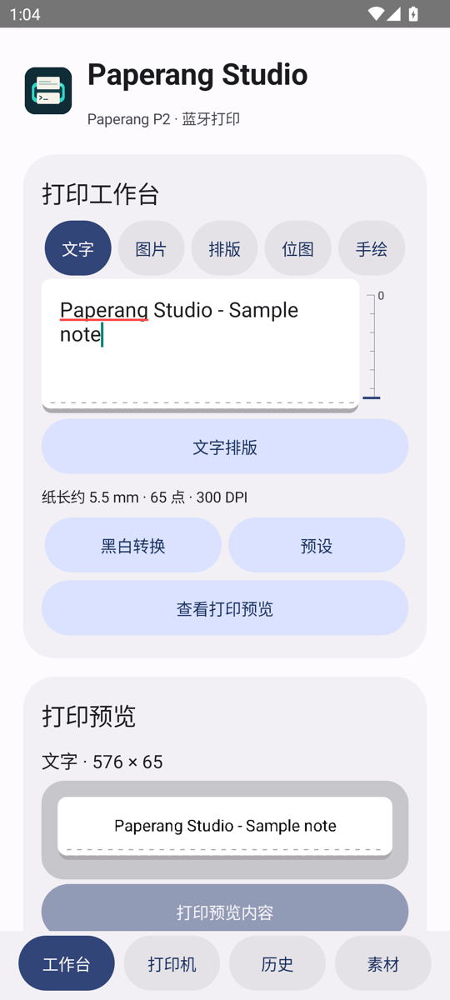
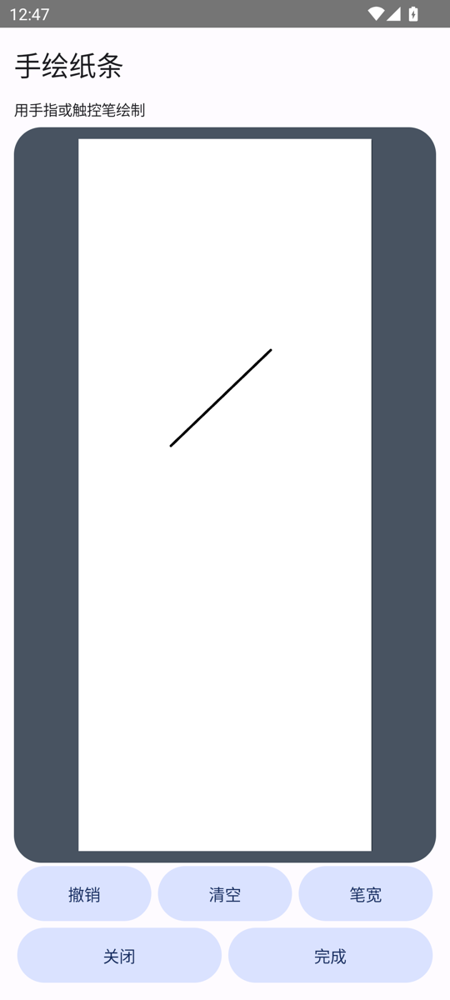
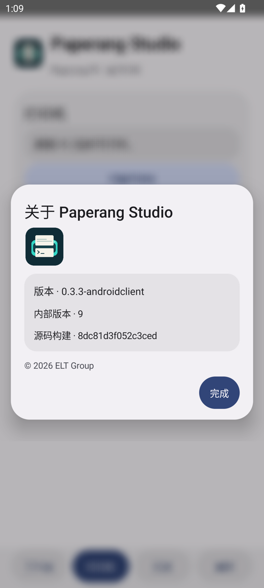

# AndroidClient

**v0.3.3-androidclient-opt1** · Android 13 或以上 · Paperang P2 BLE。使用 MacClient 的 576 点工作台、raster1 schema 1 和传统 P2 打印协议。

  

## 构建与安装

应用 ID 为 `com.elt.pprstudio.adc`。旧测试包 `studio.paperang.android` 与新版可同时安装，各自保有私有打印历史。

使用 JDK 21、Android SDK Platform 36、Build Tools 36.1.0。构建脚本直接调用 SDK 工具。首次构建从 Maven Central 下载 ZXing Core 3.5.4 并验证 SHA-256，后续可复用缓存。SDK 路径优先读取 `ANDROID_HOME` 或 `ANDROID_SDK_ROOT`，在 macOS 默认使用 `~/Library/Android/sdk`。

```sh
./Android/build.sh
adb install -r Android/build/PaperangStudio-Android-debug.apk
```

调试密钥保存在 `Android/build/debug.keystore`，保留它可覆盖安装后续本地构建。版本变更见[发行说明](../doc/RELEASE-v0.3.3-androidclient.md)。

## 打印工作台

- **文字**支持字体族、字号、粗体、行距、边距、内容宽度和对齐。
- **图片**通过系统选择器导入，支持旋转、适配宽度、保持像素、裁切填满和对齐。
- **高级排版**支持 120–1400 点纸长和最多 24 个图层。可插入文字框、标签、图片和二维码，拖动或精调对象的位置和尺寸，调整层级，点按「应用」提交属性修改，给选定文字设置字体、字号、粗体或斜体。二维码支持纯文字、HTTP(S) 和邮件地址，可设置纠错级别、模块形状与外框。
- **黑白转换**提供阈值、Floyd–Steinberg、有序抖动，以及亮度、对比度、Gamma 和反相。导入的 raster1 / RAW 已是点阵，直接使用原始黑白数据。
- **预设**提供默认、照片、标签和线稿，也可导入导出与 MacClient 共用的版本 1 工作台参数。Android 使用系统字体映射和固定 BLE 传输参数。
- **打印预览**用于屏幕核对、PNG / RAW / raster1 JSON 导出和实际打印。点按预览或「查看原始点阵」可按 1:1 像素滚动检查细节。编辑后自动刷新，也可立即更新，预览宽 576 点、最长 1400 行。

### 工作台导航

「文字」「图片」「排版」「位图」「手绘」可直接切换。工作台底部的「查看打印预览」跳到黑白预览，预览有效时可查看原始点阵或导出文件。底栏「历史」可浏览打印和送纸记录，包括参数、结果与时间。

### 纸长尺标与触屏排版

文字和图片编辑区右侧显示输出纸长尺标。排版画布右侧的尺标随纸面缩放和平移，蓝色横线标记最终位图的末行。毫米按 P2 标称 300 DPI 换算，纸长仅计位图，打印前后送纸在打印设置中单独指定。

- 「添加对象」插入文字框、标签、图片或二维码。「图层」可以选中被遮挡的对象。
- 点按对象后，拖动内部可移动，拖四角圆点可调整尺寸。「属性」可按纸面点数填写 X、Y、宽高及层级，「复制」可从当前对象新建一层。
- 双指在纸面平移或缩放。「适合纸张」恢复整张视图。「纸张」可以开关中心线吸附。高级排版默认自动截断最后一个有黑点的行之后的空白，保留顶部与中间留白。关闭自动截断可指定固定纸长。打印设置中的送纸行数单独生效。
- 手势结束后自动刷新黑白预览。选框、圆点和中心线只显示在编辑画布。

从底部「打印机」入口扫描并连接 P2，可刷新电量、纸仓和浓度。回到「工作台」核对预览和份数后确认打印。打印设置可调整浓度、份数、前后送纸及份间送纸，也可单独应用并回读浓度，或手动送纸。断开连接会停止后续发送，已经送到打印机的数据可能继续出纸。底部「历史」保留时间、参数、结果和实际发送所用的点阵。可查看打印内容、恢复任务继续编辑，或把点阵作为透明插画插入当前排版。新任务恢复原始文字、图片、图层和打印参数。仅保存点阵的任务会恢复为一个图片图层。删除记录同时移除本地点阵和可编辑任务。

## 手绘与本地素材

在工作台进入「手绘 → 全屏绘制」。可用单指或触控笔画线，切换笔宽，逐笔撤销或清空。顶部宽度尺与右侧长度尺采用独立的 Material 强调色底板，毫米刻度随纸面移动和缩放，双指同向拖动可平移，捏合可围绕两指中心缩放。点按「适合纸张」可恢复整张视图。点按「完成」回到工作台，继续绘制、打印预览、插入当前排版或导出 raster1 JSON。点按「存为素材」可命名并保留到本地素材库。

在其他纸条的「排版 → 添加对象 → 本地手绘素材」选择「使用素材」，可将手绘作为透明背景图片图层插入，并调整坐标、尺寸与层级。底部「素材」汇总所有手动保存的素材，可查看、插入排版、导出和删除。

## 核对安装版本

打开「打印机 → 关于与版本」，查看版本号、内部版本和源码构建号。构建脚本把同一个源码构建号写入 APK，并在 `Android/build/SHA256SUMS` 输出 APK 的 SHA-256。

## BLE 打印节奏

连接时请求较大的 ATT MTU。单次写入上限为协商 MTU 减 3、打印机通告上限和 180 字节三者中的最小值。MTU 仍为默认值 23 时，每次最多发送 20 字节。打印位图沿用 MacClient 的 1008 字节协议帧，最多 14 行。每次写入按 10 ms 的起始间隔调度，同时等待 Android 写入回调和打印机流控额度；帧间没有额外暂停。连接后可在打印机页查看当前 BLE 写入上限。

## 界面与版权

应用内对话框使用统一的圆角浮层、动态色和过渡。支持窗口模糊的设备会模糊背后页面，其他设备使用加深的背景遮罩。手绘使用深色托盘和白色纸面。

© 2026 ELT Group
