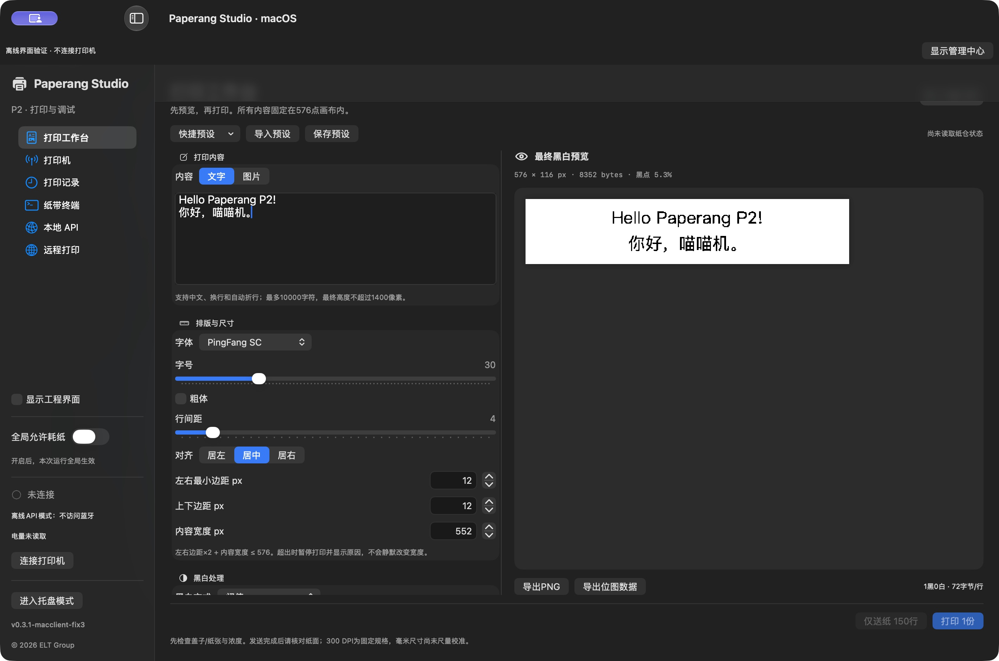
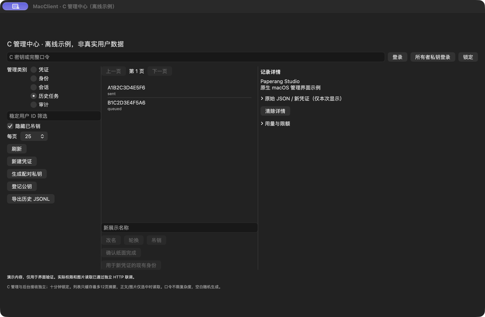
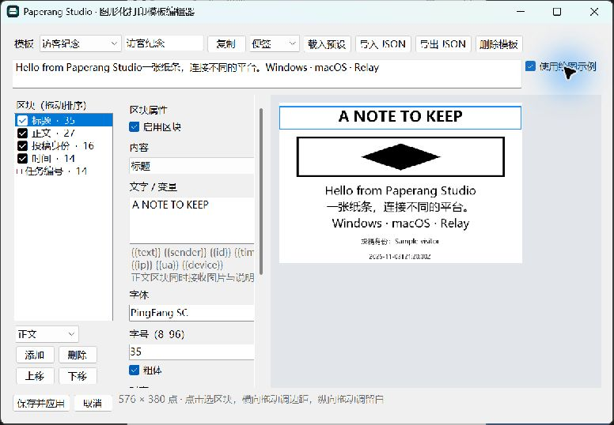
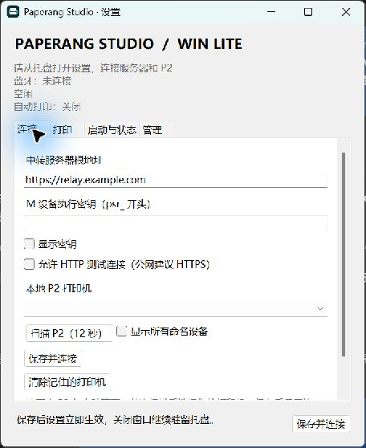
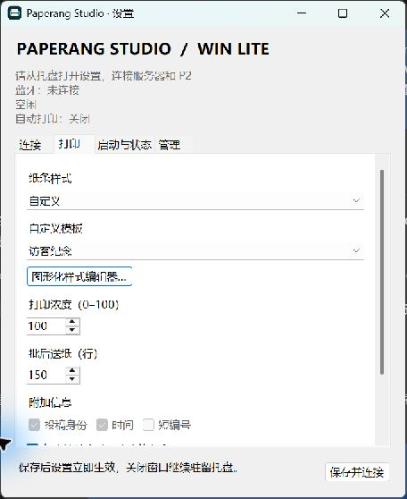

<p align="center"></p>

# Paperang Studio

**Current optimization: opt1.** [Code cleanup, interface changes and validation](doc/OPTIMIZATION-opt1.md).

<p align="center"><strong>Native clients, a shared relay, and real paper.</strong><br>macOS · Windows · Linux Relay · Web · RelaySkill · ChatGPT integration</p>
<p align="center"><a href="README.md">English</a> · <a href="doc/README.zh-CN.md">简体中文</a> · <a href="VERSIONS.json">v0.3.1 baseline</a> · <a href="doc/FEATURE-MATRIX.md">Feature matrix</a></p>

Paperang Studio is a multi-platform printing ecosystem for the **Paperang P2**. A native desktop client connects to the printer over Bluetooth; the Linux relay accepts notes from a browser or RelaySkill and delivers them to the receiving client. Shared templates, content formats and permissions keep these parts working together.

Use **MacClient** for the full print workspace and paper terminal, or **WinLite** for a lightweight Windows tray receiver with template editing and native administration. The relay and sender tools can run independently of the desktop platform.

[Choose your platform](#platforms) · [See WinLite](#windows-lite-in-action) · [Get started](#get-started) · [Documentation](#documentation)

## Platforms

| Distribution | What it does | Start here | v0.3.1 verification |
|---|---|---|---|
| **MacClient · macOS** | SwiftUI/CoreBluetooth app: text/image workspace, template editor, paper terminal, local API and relay receiver | [Mac guide](doc/USER-GUIDE.md) · [Build](doc/ARCHITECTURE.md) | Native build, GUI and local API v2 integration verified |
| **WinLite · Windows** | Native WinForms/BLE tray receiver: automatic printing, saved templates, sign-in startup, C management and history export | [Windows guide](doc/WINDOWS.md) · [Build](Windows/README.md) | Windows build, regression and local relay integration tested |
| **LinuxRelayServer · Linux** | HTTP/SQLite relay, submission webpage, identities, permissions, queue and administrative API | [Server setup](Server/README.md) | Local HTTP/SQLite tests passed; Linux deployment validation pending |
| **ChatGPT integration · experimental** | MCP sender adapter and legacy GPT Actions schema for Relay API v2 | [Integration guide](doc/CHATGPT.md) · [Code](Integrations/ChatGPT/) | Source only; gateway, ChatGPT connection and hardware test pending |
| **RelaySkill · sender** | Agent skill for text/images, layout parameters, explicit submission and permission-aware status tracking | [Skill guide](doc/RELAY-SKILL.md) · [Skill source](Skills/paperang-relay-print/SKILL.md) | Local protocol/rendering tests passed |

Full **WinClient** and **LinuxClient** are planned distributions. WinLite is the existing Windows receiver; LinuxRelayServer is a server, not a Linux Bluetooth client. See the [implementation matrix](doc/FEATURE-MATRIX.md) for exact scope and evidence.

**ChatGPT (experimental):** A private MCP / GPT Actions source adapter is available at [Integrations/ChatGPT](Integrations/ChatGPT/README.md), with [English](doc/CHATGPT.md) and [中文](doc/CHATGPT.zh-CN.md) guides. This is not a deployed or released distribution; authenticated HTTPS/OAuth gateway and account-side connection are still required.

## How the parts connect


Choose **one active Bluetooth receiver per printer**. The relay handles identity and delivery; the receiving client owns the final template, density, feed and physical print operation. MacClient also supports local printing without a relay.

## MacClient upgrade

Current **0.3.1-macclient-opt1**: [optimization review](doc/OPTIMIZATION-opt1.md) · [owner-file upgrade guide](doc/MACCLIENT-v0.3.1.md). Native owner-file reception, paginated C management and saved configuration now align with the current relay and WinLite contract.




Screenshots show the previous fix3 workspace with offline example data. Current opt1 reorganizes remote printing into Tasks, Connection, Style and Management.

## Windows Lite in action

**Edit the paper, block by block.** Shared v1 template JSON, live monochrome preview, text and raster composition, typography, spacing and reusable presets.

<p align="center"></p>

**Configure it once, keep it in the tray.** Connection and print settings stay in native Windows dialogs; settings also provide the C administration entry point.

<table>
<tr><th>Relay and printer connection</th><th>Templates and print settings</th></tr>
<tr>
<td></td>
<td></td>
</tr>
</table>

<sub>Actual v0.3.0 WinLite windows with example settings and sample content. [Screenshot notes](assets/screenshots/README.md). MacClient screenshots and validation appear above.</sub>

## What you can do

- **Send a note from elsewhere.** Submit text or a raster drawing through the webpage or RelaySkill, then let a configured desktop receiver print it.
- **Make the paper your own.** MacClient and WinLite share block-template JSON, presets, text/image composition and a 576-dot output format. Font rendering can differ across systems.
- **Run a quiet Windows receiver.** WinLite starts in the tray, remembers credentials with DPAPI, restores templates, offers sign-in startup and retries server outages in bounded batches.
- **Manage access from a native client.** A keys submit only; anonymous browser sessions can track their own jobs; B also reads its identity’s status; C manages identities, credentials, sessions, owner public keys and full history. M is the separate printer-execution credential. C history can be filtered and exported as JSONL with raster content.
- **Use the full Mac workspace.** Print transformed/dithered images, work with an interactive zsh paper terminal, inspect protocol readings, or integrate through the local HTTP API and Python/JavaScript clients.
- **Keep delivery states honest.** `sent` means data reached the transport; `confirmed` requires a manual paper check. Interrupted or uncertain output is not automatically reprinted.

## Get started

### Windows · WinLite

Requires Windows 10 2004+ / Windows 11, a BLE adapter, and .NET 10 Desktop Runtime for the lite package. To build, install the .NET 10 SDK and run:

```powershell
.\Windows\scriptsuild.ps1
```

Run `PaperangStudio.exe` from a stable directory. Open settings from the tray, enter the v0.3.1 relay URL and a **paired owner private-key file**, scan/select your P2, and choose **保存并连接**. Automatic connection and printing are enabled by default after configuration; both are configurable. Settings → **管理** opens C administration. [Full Windows instructions](doc/WINDOWS.md).

### macOS · MacClient

Requires macOS 14+ and Swift 6 / Xcode 16+:

```sh
./scripts/build.sh
open '../PaperangStudio-Development/Release/Paperang Studio.app'
```

Scan/connect on the Printer page, preview a note, and enable the global paper switch before printing. Relay mode uses an M credential; the C panel provides administration. [Mac guide](doc/USER-GUIDE.md) · [Native validation handoff](doc/HANDOFF-v0.3.0.zh-CN.md).

### Linux · Relay server

On a supported Ubuntu/systemd host, review the installer and [migration guide](doc/UPGRADE-v0.3.0.md), then:

```sh
sudo bash Server/install.sh
```

The installer uses a dedicated Python venv with `argon2-cffi` and `cryptography`. Configure HTTPS for browser access and connect a desktop receiver. [Deployment, credentials and temporary mode](Server/README.md).

### Agents · RelaySkill

Install the folder `Skills/paperang-relay-print/` into your agent’s skills directory. Configure an **A or B** random key, then invoke `$paperang-relay-print` with the text/image and desired rendering parameters. The sender never borrows the receiver’s M credential. [Installation and parameters](doc/RELAY-SKILL.md).

> **Upgrading from v0.2.x?** Relay API v2 requires a coordinated upgrade. Old relay `/v1` and receipt-content access are retired; the **Mac local API remains v1**. Read the [upgrade/rollback guide](doc/UPGRADE-v0.3.0.md), [auth contract](doc/AUTH-v2.md) and [validation record](doc/VALIDATION-v0.3.0.md) before deployment. Source availability does not imply every platform is already deployed or natively validated.

## Documentation

[English index](doc/README.md) · [中文文档目录](doc/INDEX.zh-CN.md)

| Explore | Guides |
|---|---|
| Choose a distribution | [Version policy](doc/VERSIONING.md) · [Feature matrix](doc/FEATURE-MATRIX.md) · [Registry](VERSIONS.json) |
| Windows | [Tray/settings/admin guide](doc/WINDOWS.md) · [Build](Windows/README.md) |
| macOS | [Workspace](doc/USER-GUIDE.md) · [Layout editor](doc/LAYOUT-EDITOR.md) · [Paper terminal](doc/TERMINAL.md) · [Tray mode](doc/TRAY-MODE.md) |
| Relay and security | [Deploy](Server/README.md) · [Authentication/API v2](doc/AUTH-v2.md) · [Data and retention](doc/RELAY-DATA.md) |
| Integrations | [ChatGPT adapter](doc/CHATGPT.md) · [RelaySkill](doc/RELAY-SKILL.md) · [Mac local API](doc/API.md) / [OpenAPI](doc/openapi.json) · [Swift modules](doc/SWIFT-API.md) |
| Upgrade and maintain | [Changelog](CHANGELOG.md) · [Upgrade](doc/UPGRADE-v0.3.0.md) · [Mac/Linux agent prompts](doc/HANDOFF-v0.3.0.zh-CN.md) · [Validation](doc/VALIDATION-v0.3.0.md) |
| Printer research | [Protocol](doc/PROTOCOL.md) · [Physical observations](doc/ACQUISITION.md) · [Research](doc/RESEARCH.md) · [Related projects](doc/RELATED-PROJECTS.md) · [Sources](doc/SOURCES.md) |

## Repository layout

| Path | Contents |
|---|---|
| `Sources/` | Native Swift/C MacClient and reusable modules |
| `Windows/` | Native WinLite, template/admin UI, build scripts and tests |
| `Server/` | Relay API v2, submission webpage, SQLite security/queue and Linux deployment |
| `Skills/` | Independently versioned RelaySkill |
| `Clients/` | Python/JavaScript clients for the Mac local API |
| `Integrations/ChatGPT/` | Experimental MCP/GPT Actions sender adapters; not a separate released distribution |
| `Configurations/` | Importable print presets |
| `assets/` | Original branding and real application screenshots |
| `doc/` | Guides, contracts, release records and research |

Build outputs stay outside the source tree: `PaperangStudio-Development/` for Mac and `PaperangStudio-Windows-Development/` for Windows. Override them with `PAPERANG_WORK_DIR` and `PAPERANG_WIN_WORK_DIR`. Keep credentials, databases and private print artifacts out of Git.

## License and contact

© 2026 ELT Group · [vox@calx.cc](mailto:vox@calx.cc)

Licensed under [CC BY-NC-SA 4.0](LICENSE): credit ELT Group, use it non-commercially, identify modifications, and follow the ShareAlike terms. Intended for personal research and learning; commercial use is prohibited. See [NOTICE](NOTICE) for attribution and the full project statement.

Paperang Studio is an independent, unofficial project. It is not affiliated with, endorsed by, sponsored by, or a subsidiary product of Paperang, its parent company, or any related companies or affiliates. All third-party names and trademarks belong to their respective owners. Referenced third-party materials retain their own licenses.

Linux security and migration preparation: [validation record](doc/LINUX-v0.3.0-VALIDATION.md). Production migration/systemd/HTTPS checks passed; native receiver/paper checks remain pending there.

Windows v0.3.1-winlite-fix3: [installer, update check and uninstall / 安装与卸载](doc/WINDOWS-RELEASE-ARTIFACTS.zh-CN.md).
