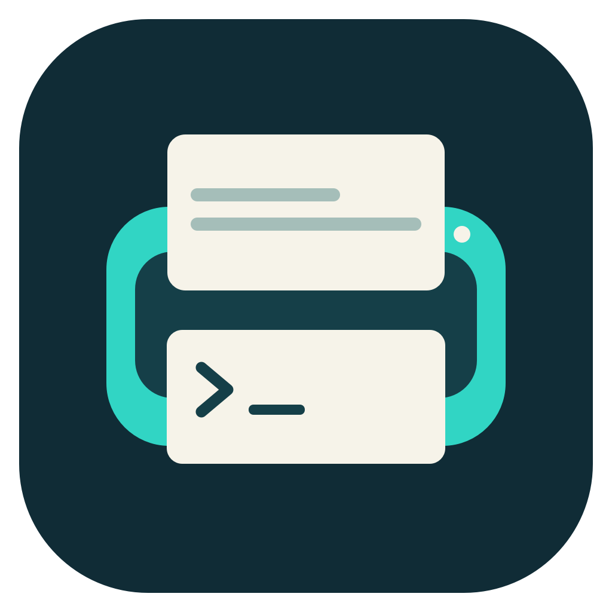
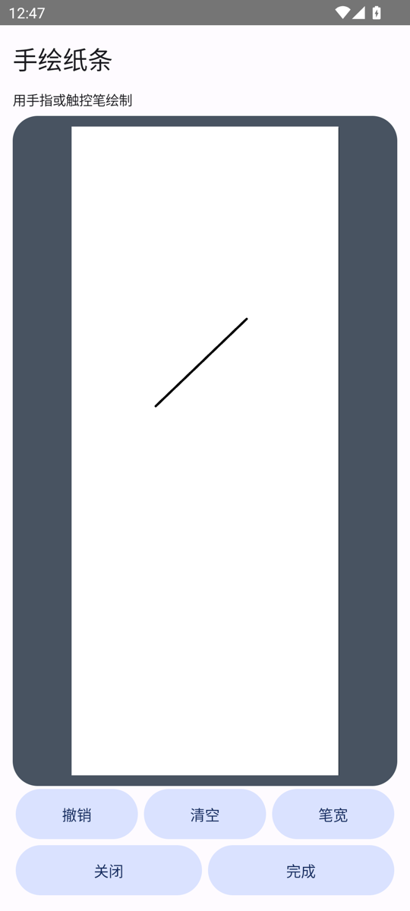

  

# Paperang Studio

[简体中文](doc/README.zh-CN.md) · [Releases](https://github.com/ELT17604/Paperang-Studio/releases) · [Documentation](doc/README.md)

Paperang Studio is a desktop and mobile printing toolkit for the **Paperang P2**. Compose and print locally, or use a self-hosted relay to send notes and drawings from a browser to a desktop receiver.

## Features

| Platform | Distribution | Features |
|---|---|---|
| macOS | [MacClient](doc/USER-GUIDE.md) | BLE printing, text and image editing, layered layouts, QR codes, paper terminal and Relay reception |
| Android | [AndroidClient](Android/README.md) | BLE printing, touch layout, full-screen drawing, rulers, reusable assets and editable print history |
| Windows | [WinLite](Windows/README.md) | USB-first printing with BLE fallback, tray reception, templates and Relay administration |
| Ubuntu | [LinuxRelayServer](Server/README.md) | Web submissions, print queue, access controls and administration |

## Screenshots

| macOS workspace | Windows template editor | Android drawing |
|---|---|---|
|  |  |  |

[More screenshots](assets/screenshots/README.md)

## Getting started

| Platform | Install | Connect |
|---|---|---|
| macOS 14+ (Apple Silicon) | Download MacClient from [Releases](https://github.com/ELT17604/Paperang-Studio/releases), then move the app to Applications | Scan for the P2 on the Printer page |
| Android 13+ | [Build and install the APK](Android/README.md) | Grant Nearby Devices access on the Printer tab, then scan for the P2 |
| Windows 10 2004+ / 11 | Download the WinLite installer or [build from source](Windows/README.md) | Open Settings from the tray and connect over USB or Bluetooth |
| Ubuntu | [Install LinuxRelayServer](Server/README.md) | Configure the Relay URL and receiver credentials in MacClient or WinLite |

After connecting, preview the output, set density and feed, then print.

## Remote printing

The browser submits notes and drawings to a self-hosted Relay. MacClient or WinLite claims each job, applies the local template and paper settings, and sends it to the P2.

[Deployment and receiver setup](doc/REMOTE-PRINTING.md) · [Authentication and permissions](doc/AUTH-v2.md)

## Build from source

| Component | Toolchain | Build |
|---|---|---|
| MacClient | Swift 6, macOS SDK | `./scripts/build.sh` |
| AndroidClient | JDK 21, Android SDK 36 | `./Android/build.sh` |
| WinLite | .NET 10 SDK | `./Windows/scripts/build.ps1` |
| LinuxRelayServer | Python 3.10+ | [Install and run](Server/README.md) |

[Source layout](doc/ARCHITECTURE.md) · [Local tests](tests/README.md)

## Documentation

- [Feature matrix](doc/FEATURE-MATRIX.md) and [versioning](doc/VERSIONING.md)
- [Relay and local HTTP APIs](doc/API-v2-032.md), [BLE protocol](doc/PROTOCOL.md) and [USB protocol](doc/USB-PROTOCOL.md)
- [Build and architecture](doc/ARCHITECTURE.md), [contributing](CONTRIBUTING.md) and [changelog](CHANGELOG.md)

## License

[CC BY-NC-SA 4.0](LICENSE) · [Notices and attribution](NOTICE)

© 2026 ELT Group
