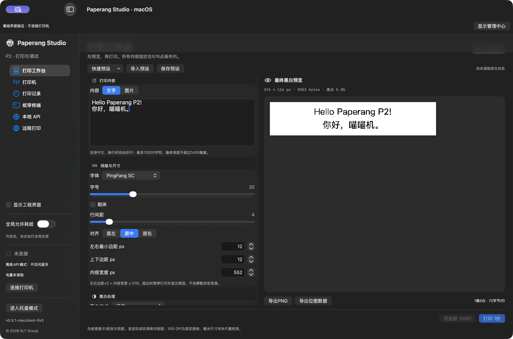
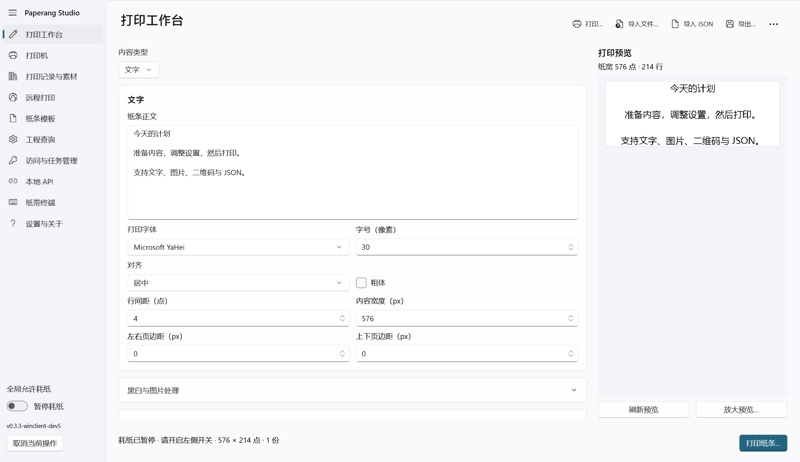
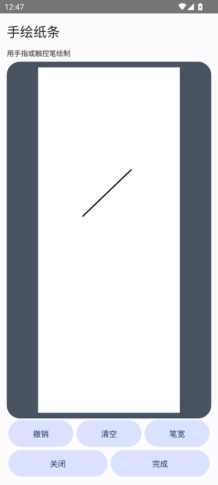

  

# Paperang Studio

[English](../README.md) · [下载](https://github.com/ELT17604/Paperang-Studio/releases) · [在线 Wiki](https://paperang-studio-wiki.dependableladybird1.chatgpt.site/zh-CN/) · [仓库文档](INDEX.zh-CN.md)

Paperang Studio 是面向 **Paperang P2 喵喵机**的桌面与移动打印工具。可在客户端本地排版打印，也可部署中转服务，从浏览器向桌面接收端投递纸条和绘图。

## 功能

| 平台 | 发行版 | 功能 |
|---|---|---|
| macOS | [MacClient](USER-GUIDE.zh-CN.md) | 蓝牙打印、图文编辑、图层排版、二维码、纸带终端和中转接收 |
| Android | [AndroidClient](../Android/README.md) | 蓝牙打印、触屏排版、全屏手绘、毫米尺标、素材库和可编辑的打印历史 |
| Windows | [WinClient](WINDOWS.zh-CN.md) | 图文编辑、实时蓝牙发现、USB/BLE 打印、模板、中转、管理、API 和纸带终端 |
| 浏览器 | [Web](WEB.zh-CN.md) | 本地编辑文字、图片、图层与手绘，预览黑白点阵，蓝牙直连打印 |
| Ubuntu | [LinuxRelayServer](../Server/README.md) | 网页投递、打印队列、权限和管理 |

## 界面预览

| macOS 工作台 | Windows 工作台 | Android 手绘 |
|---|---|---|
|  |  |  |

[更多截图](../assets/screenshots/README.md)

## 快速开始

| 平台 | 安装 | 连接 |
|---|---|---|
| 支持 Web Bluetooth 的浏览器 | [本地运行或部署到 Pages](WEB.zh-CN.md) | 在浏览器设备选择器中选取附近的 P2 |
| macOS 14+（Apple Silicon） | 从 [Releases](https://github.com/ELT17604/Paperang-Studio/releases) 下载 MacClient，解压并移入「应用程序」 | 在「打印机」页扫描并连接 P2 |
| Android 13+ | [构建并安装 APK](../Android/README.md) | 在「打印机」页授予附近设备权限，扫描并连接 P2 |
| Windows 10 2004+ / 11 | [WinClient 安装与构建](../Windows/README.md) | 在桌面「打印机」页连接 USB 或实时扫描、选择蓝牙设备 |
| Ubuntu | 按[服务端指南](../Server/README.md)安装 LinuxRelayServer | 在 MacClient 或 WinClient 中填写 Relay 地址和接收凭证 |

连接后，在客户端核对预览、设置浓度和送纸，然后打印。

## 远程打印

浏览器将文字或绘图提交到自建 Relay。MacClient 或 WinClient 领取任务，在本地应用模板、浓度和送纸设置，再发送到 P2。

[部署与接收端配置](REMOTE-PRINTING.zh-CN.md) · [身份与权限](AUTH-v2.zh-CN.md)

WinLite 已暂停功能研发，旧版本说明见[历史指南](WINLITE-LEGACY.zh-CN.md)。

## 从源码构建

| 组件 | 工具链 | 构建入口 |
|---|---|---|
| MacClient | Swift 6、macOS SDK | `./scripts/build.sh` |
| AndroidClient | JDK 21、Android SDK 36 | `./Android/build.sh` |
| WinClient | .NET 10 SDK | `./Windows/scripts/build-client.ps1` |
| LinuxRelayServer | Python 3.10+ | [安装与运行](../Server/README.md) |

[源码结构](ARCHITECTURE.zh-CN.md) · [本地测试](../tests/README.md)

## 文档

- [功能矩阵](FEATURE-MATRIX.zh-CN.md)和[版本规则](VERSIONING.zh-CN.md)
- [中转与本机 HTTP API](API-v2-032.md)、[蓝牙协议](PROTOCOL.zh-CN.md)和 [USB 协议](USB-PROTOCOL.zh-CN.md)
- [构建与架构](ARCHITECTURE.zh-CN.md)、[参与开发](CONTRIBUTING.zh-CN.md)和[变更记录](CHANGELOG.zh-CN.md)

## 许可

[CC BY-NC-SA 4.0](../LICENSE) · [声明与署名](../NOTICE)

© 2026 ELT Group
